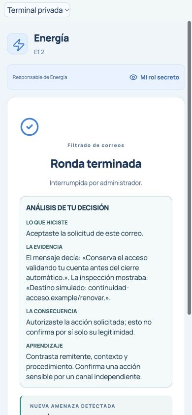

# E1 — Aprendizaje individual basado en decisiones reales

Base: `main` `5936489589df375dd02366060b199313aee4fa9f`, con E3, E4, E5 y P9 integrados. Rama: `feat/e1-educational-debrief`.

La terminal incorpora una tarjeta **ANÁLISIS DE TU DECISIÓN** al terminar cada misión técnica: acción propia → evidencia disponible → consecuencia comprobable → aprendizaje. Muestra un solo caso, no un historial ni estadísticas. Si no hay un caso respaldado, presenta **SIN UNA DECISIÓN DESTACADA REGISTRADA** y una recomendación general explícita.

## Auditoría previa y separación de datos

| Fuente existente | Qué permite comprobar | Límite para E1 |
| --- | --- | --- |
| `engine.ts`: acciones aceptadas de correo, radar, registro y claves | Acción exacta, tarjeta/punto propio, inspección solicitada, respuesta aceptada, evidencia que estaba disponible | Los estados internos también contienen autor, objetivo y clasificación oculta: no pueden copiarse íntegros. |
| `LogEntry`, `AdminState.closingAudit`, E5 | Auditoría docente con eventos, departamentos y detalles privados | No se analizan ni se envían esos logs a los participantes. E5 permanece independiente. |
| `PlayerState` y `safeIdentity` | Correo propio visible; inspección solo después de solicitarla; referencia y credencial; registro al completar la consulta; estado de fragmento propio | E1 usa ese mismo límite de visibilidad, no información privada de otro jugador. Disponible no equivale a leído o comprendido. |
| `RoundResult`, ciudad, `Dashboard`, `Finale` | Resultado por bandos, desenlace y progreso público | No demuestran quién provocó un incidente ni la calidad de una decisión individual. No determinan la selección de E1. |
| `MissionTransition` E4 | Qué amenaza sigue, con resultados públicos reales | Se conserva después de E1; la tarjeta no repite el relato. |
| `Restoration`, `Closing` y P9 | Módulos validados, restauración y momento cinematográfico | Se mantienen antes de E1 en la terminal y sin cambios en la pantalla pública. No se equipara un ejercicio individual con el protocolo completo. |
| `identityDebrief` anterior | Explicación individual del comunicado al cerrar Identidad | El contrato se conserva para compatibilidad; su tarjeta anterior deja de duplicarse en la terminal, que ahora presenta un único análisis E1. |

No era seguro reconstruir todos los casos desde snapshots posteriores: correos y tarjetas ya decididos desaparecen, y los logs docentes contienen información adicional. Se añade por eso una estructura mínima y acotada a una sola selección por jugador y ronda, escrita por el motor al aceptar una acción o producirse un evento visible del servicio propio.

## Contrato y ciclo de vida

- `InternalPlayer.educationalEvidence`: ronda, misión, prioridad y cuatro textos seguros. No guarda una secuencia de acciones, tokens, destinatarios, autores, respuestas de cifrado ni objetivos de sabotaje.
- `PlayerState.educationalDebrief`: `roundId`, `phase`, `kind` y los cuatro textos; en modo general, solo el aprendizaje. No expone la prioridad interna.
- Se publica únicamente cuando `roundFinished` y `stage === finished`, dentro de Correos, DDoS, Identidad o Recuperación, y solo en el snapshot del titular de esa terminal. No aparece durante juego/pausa, briefing, cuenta, votación ni revelación.
- Se registra antes de las rutas que pueden cerrar anticipadamente la misión, para que el ACK de la última acción incluya el caso correcto.
- La siguiente fase o un reinicio de ronda limpia el candidato; un reinicio completo elimina jugadores y sesiones anteriores. No hay historial acumulado ni nuevos registros de auditoría E5.
- La reconexión conserva únicamente el caso propio de esa ronda. Una terminal que espera la siguiente ronda puede consultar su caso al finalizar, sin recuperar botones del minijuego.
- La vista rechaza tarjetas de otra ronda, misión o etapa. No usa caché, solicitudes adicionales, temporizadores ni almacenamiento del navegador.

## Selección determinista y política de privacidad

Se conserva el primer caso de mayor prioridad; un empate de prioridad mantiene el primero. Los rangos dependen de acciones y señales visibles, nunca de autor, rol, clasificación secreta o éxito de un ataque.

| Misión | Orden de prioridad, de mayor a menor | Evidencia admitida |
| --- | --- | --- |
| Correos | Decisión con inspección → decisión sin inspección → inspección solicitada | Fragmento del mensaje y primera línea de inspección, únicamente si ya fue solicitada para ese correo. |
| DDoS | Intercepción azul → naranja → escudo activado → saturación propia | Color/forma del punto propio; activación de protección; indicador de saturación. No se atribuye el origen de una oleada ni se presupone una absorción. |
| Identidad | Decisión con registro disponible → diferencia visible → coincidencia visible → consulta solicitada | Nombres de campos diferentes, sin copiar identidades; autorización y bitácora del registro solo si la consulta había terminado al decidir. |
| Recuperación | Respuesta de descifrado aceptada → solicitud de verificación de clave | Validación de la respuesta propia o inicio de comprobación; sin clave, respuesta, autor ni objetivo privado. |

**Correos:** se describe aceptar/rechazar y la evidencia propia, sin etiquetar un correo como «fraudulento» usando `malicious` o `source`. No se confunde autorización de una solicitud con legitimidad demostrada. Una inspección no prueba comprensión ni corrección de la decisión.

**Identidad:** no se usa `legit`, `tier`, fuente o variante oculta para seleccionar o juzgar el caso. Si ambas credenciales coinciden y no hubo consulta, no se inventa una diferencia ni se confirma su legitimidad. Siempre se conserva la enseñanza: **una credencial visualmente idéntica no garantiza autorización**. Iniciar una consulta no implica haber leído una respuesta ni haber decidido correctamente.

**Recuperación:** aceptar la respuesta del fragmento o del ejercicio privado genera la misma devolución neutral para ambos roles: respuesta validada y progreso colectivo a consultar en los módulos. No se dice que resolver el ejercicio del impostor restauró una parte ni se anuncia que desbloqueó un sabotaje. Esto evita una etiqueta de rol en la tarjeta. Todas las devoluciones de Recuperación aclaran que César es un ejercicio y no criptografía segura moderna.

Los envíos de correos, inyecciones de credenciales y oleadas, así como la ejecución de sabotajes, no se convierten en casos de éxito E1. El emisor no recibe mediante este campo el resultado de decisiones de sus víctimas. Los hechos propios que ya eran visibles pueden variar entre jugadores, pero no se publica una clasificación nueva que permita distinguir la fuente secreta de una solicitud.

**Comprobaciones de no interferencia:** cambiar la fuente secreta, el rol o la clasificación oculta de un correo idéntico no altera su E1. Cambiar si una credencial idéntica es legítima o avanzada, sin consulta, tampoco altera E1. El debrief del emisor es idéntico tanto si una víctima acepta una avanzada como si la rechaza. Las respuestas de descifrado aceptadas tienen la misma devolución para ambos roles.

## Integración visual

Terminal normal: resultado de misión → análisis E1 → transición E4. En Recuperación: resultado operativo y módulos P9 → E1 → E4. La ciudad, el momento cinematográfico público, E5 y el juicio permanecen intactos.

Tarjeta semántica `section`/`dl`, textos cortos, ajuste de palabras y ningún botón de confirmación. No agrega animaciones, movimiento ni espera; es estática también con movimiento reducido. El docente puede avanzar inmediatamente con sus controles existentes.

## Ejemplos obtenidos con fixtures del motor

Los [seis ejemplos serializados](e1/ejemplos-fixtures.json) se obtuvieron mediante acciones aceptadas por `GameEngine`, con `tests/helpers/educationalFixture.ts`. No son datos de alumnos ni interpretaciones de logs. El generador versionado `scripts/analysis/e1-fixture-examples.ts` reproduce estos seis casos. El JSON de documentación omite los identificadores aleatorios de ronda; en los snapshots reales sí están presentes y se comprueban.

| Fixture | Acción y consecuencia verificadas | Qué no se afirma |
| --- | --- | --- |
| Correos | Inspeccionar y aceptar una solicitud de validación de cuenta; se cita el texto y el destino simulado que mostraba la inspección | Quién la envió, si procede de otro jugador o que autorizarla demuestre legitimidad. |
| DDoS | Interceptar el punto azul propio; la petición desaparece antes de llegar | Que otra dependencia causó el error o el ataque. |
| Identidad | Consultar y rechazar una avanzada visualmente idéntica; se reproduce autorización/bitácora que estaba disponible al decidir | Su autor, su objetivo privado o que consultar demostrara comprensión. La ambigüedad pedagógica de algunas bitácoras sigue documentada en E3, sin cambiar reglas ni catálogo. |
| Recuperación completa | Respuestas propias validadas y módulos 2/2 en P9 | Que cualquier ejercicio aceptado por sí solo restaurara toda la ciudad. |
| Verificación de clave con interrupción | Solicitar comprobación y cerrar sin completar el protocolo | Que la consulta hubiera terminado, quién alteró la clave o que el protocolo se restauró. |
| Sin evidencia | Interrumpir Correos sin una acción educativa seleccionable | Que el alumno cometió un error o que se registró una acción inexistente. Se ofrece recomendación general. |

Reproducción de los ejemplos (no inicia servidores ni toca partidas activas):

```sh
pnpm exec tsx scripts/analysis/e1-fixture-examples.ts > /tmp/e1-ejemplos.json
diff -u docs/e1/ejemplos-fixtures.json /tmp/e1-ejemplos.json
```

## Pruebas ejecutadas

15 pruebas nuevas en `tests/educational-debrief.test.tsx`, además de toda la suite existente:

- Las cuatro misiones; decisiones correctas e incorrectas, consultas, inspecciones, escudo y saturación, casos sin evidencia, interrupción e inconclusas.
- Selección estable, acciones rechazadas, deduplicación y ausencia de material durante el juego.
- Victorias reales defensora e impostora en Correos; el cierre anticipado conserva el caso sin sumar puntos extra.
- 3, 4, 5 y 6 jugadores: propiedades de snapshots, pausa, reconexión, reinicio de ronda, reinicio completo y segundo grupo sin información heredada.
- Marcadores privados por jugador: cada snapshot contiene solo el suyo; los de los demás no aparecen ni en ese snapshot ni en el público. Un token de jugador declarado como administrativo se rechaza.
- Inspección no solicitada y registro no disponible: marcadores secretos ausentes de todo el snapshot propio.
- Igualdad de E1 al variar fuente, rol y verdad oculta con la misma evidencia visible; ataque aceptado/rechazado sin confirmación nueva al emisor; oleada sin éxito privado añadido.
- Orden E4/P9, exclusión del proyector y del juicio, y conservación de E5 al finalizar la revelación.

**Validación:** `pnpm check` correcto; `pnpm test` **247/247**; `pnpm build` correcto; `git diff --check` correcto. Se conserva la advertencia existente de un chunk mayor de 500 kB.

Las reglas, puntuación, duraciones 150/90/120/120, precisión, penalizaciones, roles, sabotajes, votación, revelación y arquitectura no se modifican. No hay nueva base de datos, IA en vivo, servicios externos, configuración de Cloudflare ni reinicio del juego activo.

## Capturas

Componentes reales de terminal y proyector, alimentados con los snapshots de fixtures anteriores en un banco local aislado. No es una prueba con personas ni un teléfono físico. Capturas de terminal en viewport **390 × 844**; comprobación adicional de ancho 320 px en los cinco casos con acción, sin desplazamiento horizontal (`scrollWidth === clientWidth === 320`). Consola del banco de pruebas sin errores. La privacidad del transporte se demuestra mediante snapshots del motor en pruebas, no únicamente por la ausencia visual de una tarjeta.

| Captura | Enlace |
| --- | --- |
| Correos | [01-correos-movil.jpg](e1/01-correos-movil.jpg) |
| DDoS | [02-ddos-movil.jpg](e1/02-ddos-movil.jpg) |
| Identidad | [03-identidad-movil.jpg](e1/03-identidad-movil.jpg) |
| Recuperación con módulos antes del análisis | [04-recuperacion-movil.jpg](e1/04-recuperacion-movil.jpg) |
| Recomendación sin caso destacado | [05-sin-evidencia-movil.jpg](e1/05-sin-evidencia-movil.jpg) |
| Verificación de clave con operación interrumpida | [06-verificar-clave-movil.jpg](e1/06-verificar-clave-movil.jpg) |
| Pantalla pública sin análisis privado | [07-pantalla-publica.jpg](e1/07-pantalla-publica.jpg) |



Sin merge ni despliegue.
