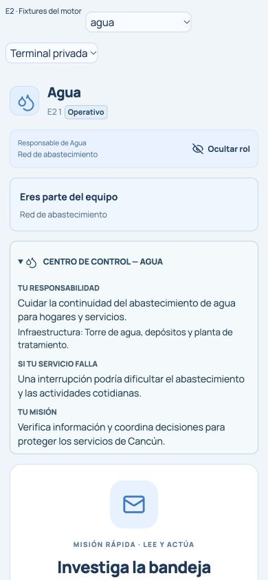
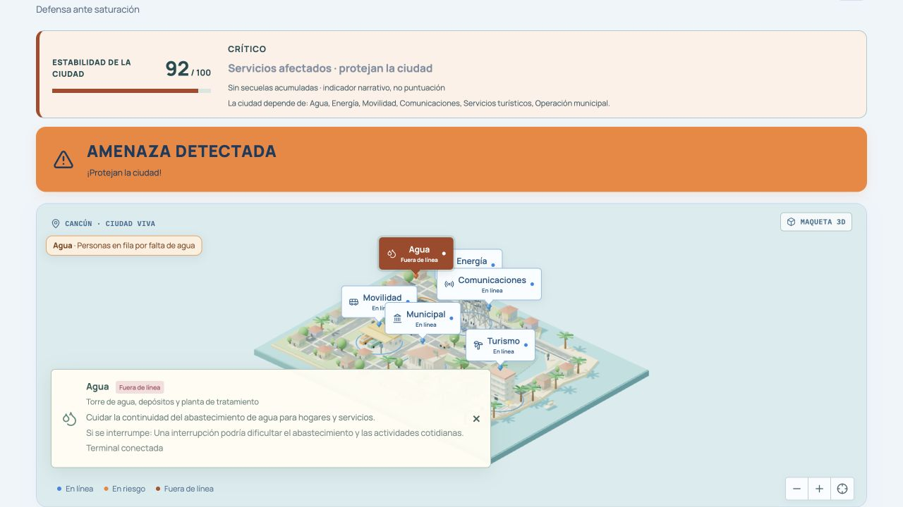

# E2 — Dependencias protagonistas y defensa de Cancún

Base: `main` `5936489589df375dd02366060b199313aee4fa9f`. Rama: `feat/e2-defender-service-identity`.

E1 (PR #15) seguía en revisión al iniciar. E2 es independiente: no copia su contrato, servidor, tarjeta ni pruebas. La identidad de servicio se incorpora a cabecera/cobertura y a un perfil opcional, separado de los resultados y de E4. Cuando E1 se integre, su debrief individual podrá ocupar su posición existente sin duplicación ni depender de E2.

## Un catálogo, seis responsabilidades

Se amplía **DEPARTMENTS en shared/types.ts**, conservando IDs, nombres, descripciones e iconos originales. Se añaden infraestructura, responsabilidad y consecuencia potencial. `SERVICE_SITES` conserva sus anclajes/coordenadas, alturas y etiquetas de la maqueta; ahora deriva la descripción de infraestructura del catálogo canónico en lugar de mantener otra copia de esos textos. No se crean otras dependencias, personajes o habilidades.

Los textos siguientes están transcritos del catálogo; las consecuencias son siempre condicionales, no incidentes declarados:

| Dependencia / función | Responsabilidad | Infraestructura de la maqueta | Si se interrumpe |
| --- | --- | --- | --- |
| Agua · Red de abastecimiento | Cuidar la continuidad del abastecimiento de agua para hogares y servicios. | Torre de agua, depósitos y planta de tratamiento | Una interrupción podría dificultar el abastecimiento y las actividades cotidianas. |
| Energía · Suministro eléctrico | Proteger el suministro eléctrico que sostiene la actividad de la ciudad. | Minitorres eléctricas, tendido, transformadores y paneles solares | Una interrupción podría detener equipos y operaciones de otros servicios. |
| Movilidad · Tránsito y transporte | Mantener la continuidad del tránsito y el transporte de personas. | Terminal urbana, autobuses y circulación vial | Una interrupción podría dificultar traslados y coordinación en las calles. |
| Comunicaciones · Conectividad de la ciudad | Proteger la conectividad que permite comunicar y coordinar los servicios. | Antena de telecomunicaciones, parabólicas y centro de datos | Una interrupción podría retrasar comunicaciones y la coordinación de respuestas. |
| Servicios turísticos · Atención a visitantes | Mantener disponibles los servicios de información y atención a visitantes. | Hotel, piscina, playa y servicios turísticos | Una interrupción podría dificultar la orientación y la atención a visitantes. |
| Operación municipal · Servicios ciudadanos | Cuidar la continuidad de los trámites y servicios ciudadanos. | Palacio municipal, plaza y fuente pública | Una interrupción podría retrasar la atención y las gestiones de la comunidad. |

## Terminal privada

- La cabecera conserva nombre, icono y apodo, e incorpora un distintivo de estado. La barra de cobertura añade la función principal en una línea breve.
- Al revelar voluntariamente el rol aparece el perfil **CENTRO DE CONTROL**, con responsabilidad, infraestructura, consecuencia potencial y misión general. El perfil no recibe el rol como entrada; su contenido y aspecto son los mismos para ambos bandos.
- Durante juego y cuenta regresiva el perfil comienza plegado. La presentación completa no ocupa de forma obligatoria el espacio de credenciales o decisiones. La apertura/cierre del rol y los controles principales siguen siendo los existentes.
- Riesgo e interrupción publicados muestran un aviso corto, también con el rol oculto. La desconexión no se presenta como ataque; sin conexión actual de la terminal se muestra estado «Sin confirmar».
- La actividad se explica como responsabilidad o recomendación, nunca como logro atribuido a un alumno. No se calculan puntos individuales ni se afirma que alguien contribuyó sin evidencia.

### Contribución general según la fase

Estas frases solo contextualizan la responsabilidad al abrir el perfil. No repiten la transición narrativa ni certifican una acción individual:

| Fase | Explicación |
| --- | --- |
| Correos | Revisar solicitudes reduce el riesgo de autorizar acciones comprometidas. |
| DDoS | Distinguir tráfico legítimo de malicioso ayuda a mantener la disponibilidad. |
| Identidad | Contrastar credenciales con una autorización independiente protege los accesos. |
| Recuperación | Validar las partes pendientes puede contribuir a reconstruir el protocolo. |
| Preparación | Verifica información y coordina decisiones para proteger los servicios de Cancún. |
| Votación | Habla de señales y decisiones; una sospecha no determina el estado de un servicio. |
| Revelación | Distingue el estado operativo de la ciudad del resultado por puntos. |

## Estado real frente a narrativa y puntuación

El distintivo y los avisos usan **solo el registro público de la dependencia** (`DepartmentState.status`), más la disponibilidad de conexión. No consultan rol, saturación privada, infiltraciones privadas, objetivos, sabotajes, votos, precisión, resultados por bandos o estabilidad de la ciudad. El último estado público puede incorporar el retraso de publicación previsto por el motor; E2 no lo adelanta.

| Dato recibido | Distintivo / mensaje |
| --- | --- |
| `operational` | **Operativo**. El servicio continúa funcionando. |
| `warning` | **Bajo presión**. El servicio presenta señales de riesgo. Mantén la vigilancia. |
| `down` | **Interrumpido**. El servicio fue afectado. La ciudad registra las consecuencias. |
| Falta el registro o el cliente está sin conexión | **Sin confirmar**. Esperando un estado actualizado del servicio. |
| Terminal ocupada sin conexión, en un registro público disponible | Mantiene el estado publicado, pero el texto aclara: «La terminal está desconectada; no se atribuye la causa a un ataque». |

Un marcador perdido no convierte un servicio operativo en interrumpido. Una huella histórica de la ciudad no es un bloqueo actual. Una restauración incompleta no se convierte en restauración completa por ganar puntos, ni se deduce la interrupción de todos los servicios al perder la misión. Se mantiene el estado operativo y el ganador estratégico de P9 como datos separados.

## Ciudad pública y cobertura del impostor

Las seis funciones se explican en las fichas existentes bajo la maqueta. Al seleccionar un servicio, el detalle existente incorpora su responsabilidad y una consecuencia potencial. El texto «La ciudad depende de…» deriva los seis nombres de DEPARTMENTS: expresa la relación entre servicios, no que haya seis terminales conectadas en una partida de tres personas.

Se conserva la ciudad Three.js, sus estados, leyendas, efectos, memoria visual y restauración gradual. No se añaden modelos, geometría, materiales, luces, animaciones, ciclos de render o temporizadores. Los descriptores de los edificios siguen siendo los mismos, con una fuente única. La presentación es estática y no introduce movimiento adicional en modo reducido. Se reposiciona el aviso existente de impacto cuando hay un detalle abierto para evitar superposiciones de texto.

No se añaden colores, insignias, sospechas, ordenaciones o mensajes de falta de contribución asociados al rol. El impostor conserva la misma identidad visible de su servicio. Su objetivo verdadero sigue en la pantalla secreta existente; revelar ese rol en la terminal privada es una acción explícita del usuario. Los ejemplos privados pueden mostrar esa pantalla, pero el proyector no recibe la identidad secreta por E2.

No se modifican snapshots, autorización, endpoints ni logs. E4, E5, P9, las reglas de victoria, puntajes, tiempos, penalizaciones y sabotajes permanecen intactos. No se reinicia el servidor ni Cloudflare.

## Pruebas

Siete pruebas nuevas en `tests/service-identity.test.tsx`, con fixtures del motor en `tests/helpers/serviceFixture.ts`:

1. Seis perfiles, contenido por fase e infraestructura del mapa derivada del catálogo único.
2. Operativo, riesgo, interrupción, registro ausente y desconexión sin inventar una causa.
3. Equivalencia exacta de cabecera/cobertura/aviso entre defensor e impostor para seis dependencias y tres estados, con el rol cerrado.
4. Partidas de 3–6 participantes, pausa y reconexión; una infiltración privada no cambia el distintivo hasta el pulso público correspondiente. La pantalla pública no muestra datos de desafíos ni tokens.
5. Restauración parcial/completa, alteración de marcador y estabilidad sin alterar el estado de servicio recibido; reinicio completo, sesiones revocadas y grupo nuevo sin resultados anteriores.
6. Apertura real del rol en React: perfil neutral idéntico para ambos bandos y plegado durante el juego.
7. Recuperación agotada por tiempo con fragmentos pendientes: resultado del impostor y restauración incompleta sin deducir interrupciones individuales inexistentes.

Validación: `pnpm check`, `pnpm test` (**239/239**), `pnpm build` y `git diff --check`. El build conserva el aviso existente de chunk >500 kB. E1 no forma parte de esta base; por eso el total no incluye sus pruebas pendientes de integración.

## Evidencia visual y alcance

Los componentes reales se montaron con snapshots producidos por fixtures aislados de GameEngine, no datos de alumnos ni conexiones al juego activo. Para el escenario afectado se inyectó carga roja controlada en la fixture y se dejó que el motor aplicara saturación/bloqueo; después se validaron fragmentos reales para observar 1/5 y 5/5. No se atribuyen esos eventos a personas.

Capturas móviles a **390 × 844** y vista de proyector a **1280 × 720**. Comprobación adicional de los seis servicios y el escenario afectado a 320 px: `scrollWidth === clientWidth === 320`, sin desbordamiento horizontal. Se comprobó texto e iconos, apertura del rol, perfil plegado durante juego y ausencia de errores de consola. No se ensayó con dispositivos físicos iPhone/Android ni se midió FPS; no se declara un rendimiento numérico. El cambio no agrega trabajo de animación o geometría al proyector.

| Evidencia | Archivo |
| --- | --- |
| Agua | [01-agua-movil.jpg](e2/01-agua-movil.jpg) |
| Energía; el rol secreto de la fixture es impostor y el perfil de servicio sigue siendo neutral | [02-energia-movil.jpg](e2/02-energia-movil.jpg) |
| Movilidad | [03-movilidad-movil.jpg](e2/03-movilidad-movil.jpg) |
| Comunicaciones | [04-comunicaciones-movil.jpg](e2/04-comunicaciones-movil.jpg) |
| Servicios turísticos | [05-turismo-movil.jpg](e2/05-turismo-movil.jpg) |
| Operación municipal | [06-municipal-movil.jpg](e2/06-municipal-movil.jpg) |
| Servicio interrumpido, rol oculto y controles de misión | [07-servicio-interrumpido-movil.jpg](e2/07-servicio-interrumpido-movil.jpg) |
| Ciudad afectada y detalle sin superposición | [08-ciudad-servicio-afectado.jpg](e2/08-ciudad-servicio-afectado.jpg) |
| Restauración parcial, 1/5 | [09-restauracion-parcial.jpg](e2/09-restauracion-parcial.jpg) |
| Restauración completa, 5/5, conservando el paso al juicio | [10-restauracion-completa.jpg](e2/10-restauracion-completa.jpg) |

Sin merge ni despliegue.
