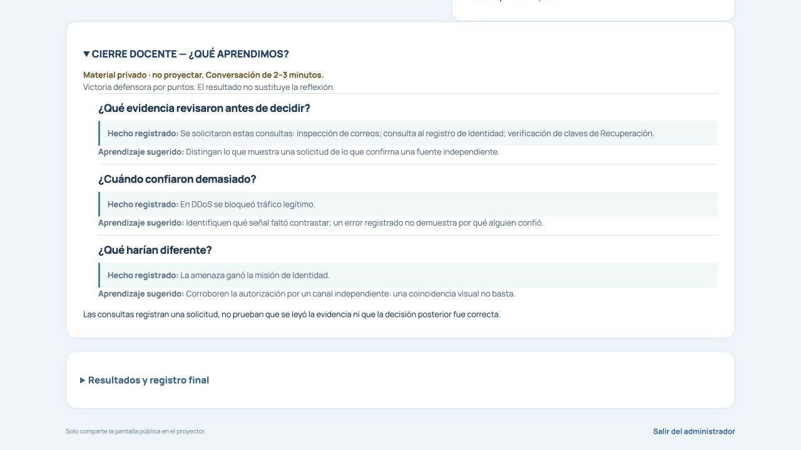
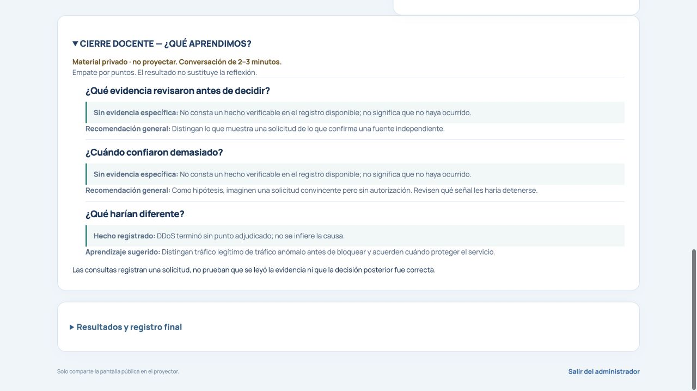

# E5 — Cierre docente basado en la partida

Base: `main`, commit `274e439`. Rama: `feat/e5-teacher-debrief`.

El panel administrativo incorpora **CIERRE DOCENTE — ¿QUÉ APRENDIMOS?**, una conversación de 2–3 minutos con tres preguntas, una observación breve cuando existe y un aprendizaje sugerido. Se encuentra después de los controles/resultados de la partida y antes del registro administrativo desplegable. Permanece cerrado por defecto y marcado como material privado que no debe proyectarse.

## Momento y alcance

Aparece únicamente con snapshot administrativo, fase revelada, paso `learning` y secuencia completa (`judgment.elapsed >= 30`). No introduce otro temporizador: utiliza la secuencia existente. Se retira al desconectarse el docente; al recuperar la sesión vuelve a calcularse con el snapshot vigente y queda cerrado. Su despliegue se identifica por sala y ronda, sin conservar texto, votos ni registros en estado local o almacenamiento del navegador.

No modifica duración, puntajes, resultado de misiones, recuperación, votación, pantalla pública ni reflexión general. No añade endpoints, campos al protocolo, dependencias, telemetría ni descargas. La descarga de auditoría existente sigue siendo independiente y opcional.

## Procedencia de las preguntas

El selector `client/teacherDebrief.ts` solo presenta hechos existentes: tipos de `LogEntry` con fase coincidente, `RoundResult` y ganador final. No reproduce `detail`, nombres, departamentos, votos, razones de voto ni descripciones libres.

| Pregunta | Fuente comprobada | Afirmación permitida |
| --- | --- | --- |
| ¿Qué evidencia revisaron antes de decidir? | `AdminState.closingAudit.logs`: `mail_inspect` en Correos, `identity_verify` en Identidad, `recovery_key_verify` en Recuperación | Se solicitaron las consultas registradas. Puede combinar las tres sin añadir contadores extensos. |
| ¿Cuándo confiaron demasiado? | `blue_lost` en DDoS; alternativamente `identity_blocked` en Identidad | Se bloqueó tráfico legítimo; o se registró un servicio comprometido. No atribuye confianza, intención ni causa mental como hechos. |
| ¿Qué harían diferente? | Resultado técnico de una misión en `PublicState.results` | Meta alcanzada, victoria de la amenaza o cierre sin punto adjudicado; acompaña una medida preventiva correspondiente a esa misión. |

La tercera pregunta prioriza una misión sin punto defensor. Si todas tuvieron victoria defensora, prioriza Identidad si está presente y, en otro caso, la primera misión técnica registrada. La votación no se trata como una misión técnica. Ganador global y hechos locales permanecen separados: victoria, derrota o empate por puntos no prueban que se cometió un error particular.

El registro de una consulta demuestra su solicitud aceptada, **no** que haya terminado, se haya leído la evidencia o se haya decidido correctamente. Por eso no se afirma «inspeccionaron antes de decidir» a partir de un evento aislado. El docente puede plantearlo como pregunta y pedir explicaciones.

Si no existe una observación verificable, aparece «Sin evidencia específica» y una recomendación general; la segunda pregunta se plantea expresamente como hipótesis. La ausencia de un evento no demuestra que no ocurrió: los registros disponibles pueden estar incompletos. No se interpretan las cadenas libres de `mail_decision` o `identity_allow` como clasificación estructurada ni se deduce un error de la precisión o de una derrota.

## Registros existentes revisados

- `AdminState` / `closingAudit`: ya están protegidos por la sesión administrativa y contienen los eventos privados al cierre. Son la fuente de las observaciones específicas.
- `LogEntry`: se usa el par fase/tipo, sin copiar ni analizar texto libre.
- `RoundResult`: proporciona el resultado de misión para seleccionar una acción preventiva sin inventar causas.
- `FinalScoreboard`: ya explica los resultados por misión. E5 respeta esa misma semántica y no duplica su tabla ni crea otro dashboard.
- `finalReflection`: la reflexión pública permanece intacta. Sus frases generales no se reutilizan como prueba de una acción particular; tampoco se envía a público una nueva auditoría administrativa.

No se crea otro motor de auditoría. El selector es una función de presentación sin mutaciones, nuevos registros ni cálculo de puntuación.

## Privacidad y robustez

El componente se monta exclusivamente en la rama del panel que exige `state && admin`. La autorización sigue siendo la del servidor existente: un token de jugador no obtiene un snapshot administrativo aunque intente declararse administrador. El proyector conserva `reveal.logs` y `reveal.votes` vacíos; las terminales no reciben `admin` ni `closingAudit` por esta funcionalidad.

El resumen no escribe en consola ni introduce exportaciones o solicitudes de red. El control de apertura solo muestra el material en el panel privado. Reiniciar el grupo elimina el cierre y sus fuentes; una segunda partida sin consultas ni errores registrados muestra recomendaciones generales, sin arrastrar el texto anterior. No se infiere que una misión inconclusa fue interrumpida, falló por presión o comprometió un servicio.

## Validación

Siete pruebas nuevas en `tests/teacher-debrief.test.tsx`:

1. Disponibilidad administrativa solo tras 30 s; ausencia durante fases anteriores y desconexión; cerrado por defecto.
2. Procedencia individual y combinada de las tres consultas; rechazo de tipos con fase incorrecta.
3. Errores por tipos específicos; los detalles libres y otros eventos no se convierten en incidentes inventados.
4. Matriz de ganador defensor, impostor o empate, resultados de las cuatro misiones y misiones inconclusas; ausencia de datos.
5. Exclusión de nombres, votos, víctimas, objetivos, descripciones y reflexión libre del material generado.
6. Partidas del motor real con 3–6 participantes: inspección, consulta al registro, sabotaje y verificación de clave, bloqueo azul, revelación, privacidad de snapshots, reconexión docente, reinicio y segundo grupo sin eventos heredados.
7. Mismo montaje React: apertura manual, desaparición al desconectar/reiniciar y reapertura cerrada al recuperar la sesión.

`pnpm check` correcto; `pnpm test` **222/222**; `pnpm build` correcto; `git diff --check` correcto. El build conserva el aviso existente de un chunk mayor de 500 kB.

La revisión de navegador usó el componente `Admin` real con estados sintéticos explícitos en una vista local aislada. Se verificaron apertura, evidencia observada frente a hipótesis y ausencia antes de completar la revelación; consola de esa vista sin errores. No fue una partida humana ni contiene datos de alumnos.

Sin merge, despliegue ni reinicio de servicios activos.
