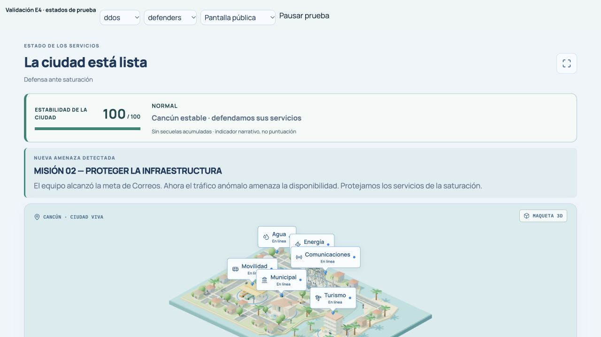
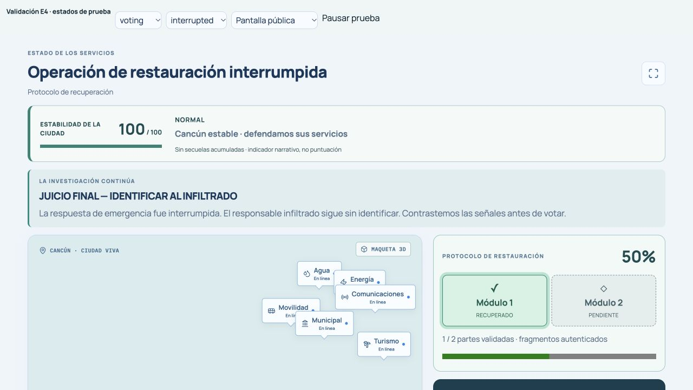

# E4 — Continuidad narrativa de la crisis

Base: `main`, commit `274e439` (PR #11 integrado).

El inicio y las cuatro conexiones se presentan en los briefings y cierres existentes, tanto en la terminal como en la pantalla pública. Son dos o tres frases: cierre observado, siguiente amenaza y motivo para actuar. Durante el juego y la cuenta regresiva no se añade una tarjeta narrativa. El juicio final conserva la transición existente de P9.

Los textos usan únicamente el resultado público de la misión anterior. Una victoria del equipo significa que alcanzó su meta; una victoria del atacante se describe como ventaja, sin atribuir daños a un servicio concreto. El cierre sin ganador se distingue de la interrupción explícita publicada por el motor. Recuperación distingue protocolo completo, incompleto e interrupción; los puntos o la estabilidad nunca sustituyen ese estado operativo. Sin resultado no se inventa un cierre. No se reproducen descripciones arbitrarias, nombres, víctimas, objetivos ni datos privados en las transiciones.

No se modifican motor, fases, comandos, puntajes, cronómetros ni autoarranque. Se conservan los 480 segundos de misiones predeterminados, los 20 segundos de lectura inicial y la cuenta de 5 segundos. El docente mantiene pausa, reanudación, reinicio, avance y apertura del juicio. La animación de entrada dura 240 ms, no retrasa controles ni oculta texto y se desactiva con `prefers-reduced-motion: reduce`.

## Evidencias visuales

Capturas del navegador a 1280 × 720 con los componentes reales, montados en una vista local aislada con estados de prueba explícitos. La barra superior pertenece al banco de pruebas, no al juego. No representan un nuevo ensayo físico con alumnos ni una partida de producción. Los resultados y el progreso temporal se comprueban además contra el motor real en las pruebas automatizadas.

| Escenario | Captura |
| --- | --- |
| Inicio de Correos | [01-inicio-correos.jpg](01-inicio-correos.jpg) |
| Correos → DDoS, meta del equipo alcanzada | [02-correos-ddos.jpg](02-correos-ddos.jpg) |
| DDoS → Identidad, ventaja de la amenaza | [03-ddos-identidad.jpg](03-ddos-identidad.jpg) |
| Identidad → Recuperación, sin ganador | [04-identidad-recuperacion.jpg](04-identidad-recuperacion.jpg) |
| Recuperación → juicio final, operación interrumpida | [05-recuperacion-juicio.jpg](05-recuperacion-juicio.jpg) |
| Terminal: briefing automático pausado tras una interrupción | [06-briefing-pausado.jpg](06-briefing-pausado.jpg) |

## Validación

- Matriz de las cuatro conexiones: victorias de ambos bandos, cierres sin ganador, interrupciones y pausas; comprobación del texto en pantalla pública.
- Estado sin resultado, juego activo, cuenta y revelación: no se inventan resultados ni se superponen transiciones.
- Mismo relato en briefing, terminal y pantalla pública; exclusión de marcadores privados de prueba.
- Motor con 3, 4, 5 y 6 participantes: autoarranque exacto de 20 + 5 s, pausa, reanudación, reinicio sin resultado anterior, tiempos de las cuatro misiones y comandos docentes hasta juicio final.
- Suite completa: `pnpm check`, `pnpm test` (219/219), `pnpm build` y `git diff --check`. El build conserva el aviso existente de un chunk mayor de 500 kB.

Sin merge ni despliegue.
